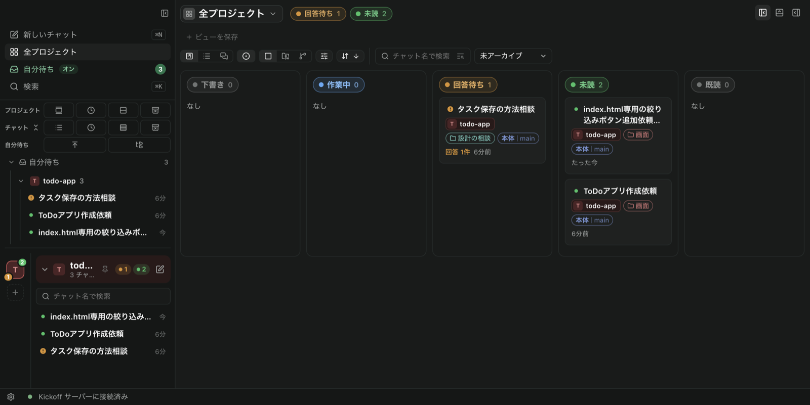
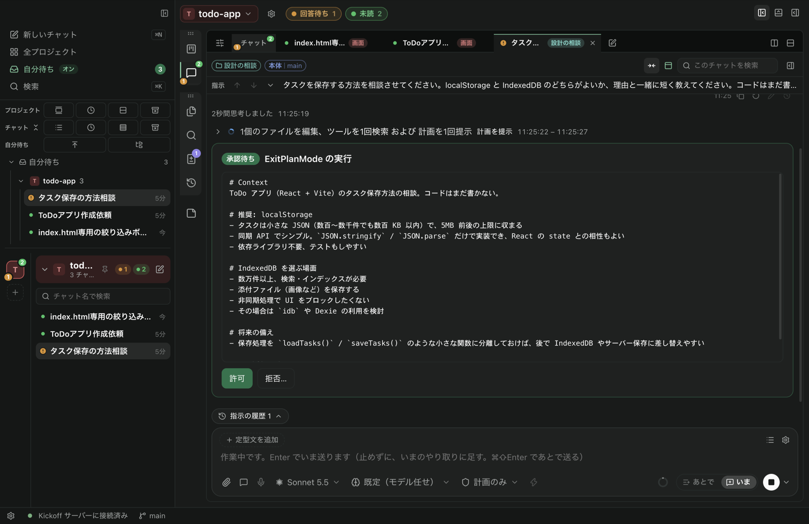

# Kickoff

> [!WARNING]
> 開発中です（v0.1）。macOS（Apple Silicon）でしか確かめていません。
> 機能・画面・保存の形は予告なく変わり、版によってはそれまでのデータを引き継がないことがあります。

アプリ開発を、AI エージェントとのチャットで進めるための Mac デスクトップアプリ。プロジェクトごとに、作業場所（git のワークツリー）・グループ・状態でチャットを並べ、並行して進める。

- 要件: [docs/requirements.md](docs/requirements.md)
- 設計（語彙・スキーマ・構成）: [docs/architecture.md](docs/architecture.md)
- 実装計画（初期のもの）: [docs/plan.md](docs/plan.md)

## 使い方

`npm install && npm run install-app` で `/Applications/Kickoff.app` に入れて起動する（前提は下の「前提」）。



1. **プロジェクトを作る**: サイドバーの「＋」から、新しいフォルダを作る（`git init` まで）か、既存のフォルダを取り込む。
2. **チャットで頼む**: 「新しいチャット」（⌘N）に指示を書いて送る。入力欄の下で、モデル・考える深さ・権限モード（毎回確認・編集は自動で承認・Auto mode・計画）を選ぶ。作業ごとにワークツリー（ブランチ）を分ければ、複数のチャットを並行して進められる。
3. **自分の番を拾う**: チャットは状態ごとに並ぶ。「全プロジェクト」のボードや、サイドバーの「要対応」（回答待ち・エラー・未読）で、返事が要るものだけを順に開く。チャットはグループでまとめられる。
4. **答える・足す**: AI の承認依頼・質問には、チャットの中で答える（下の画面は、計画の承認待ち）。作業中でも、入力欄の「いま」で止めずに伝えるか、「あとで」で送信待ちに積める。



5. **確かめて出す**: 「変更」タブで差分を見てコミット・プッシュし、ワークツリーの帯から GitHub に PR を作る（マージは GitHub で）。ターミナル・ブラウザ・メモもアプリの中で開ける。外出中は、スマホのブラウザから承認・回答・次の指示ができる（同じ Wi-Fi か Tailscale。QR でペアリング）。

## 前提

- macOS（Apple Silicon）、Node.js 22.13 以上
- Claude Code にログイン済み（Kickoff は Agent SDK に同梱された Claude Code を使い、そのログインで動く。API キーは不要）
- GitHub CLI にログイン済み（`brew install gh && gh auth login`）

## 開発

```sh
npm install
npm run dev        # Electron アプリを開発モードで起動
npm test           # コアの単体テスト
npm run typecheck  # 型チェック（使っていない import・変数も見る）
npm run daemon     # Electron なしでコア（API サーバー）だけを起動
npm run dist       # .app / .dmg を作成
npm run install-app  # ビルドして /Applications/Kickoff.app（本番）を入れ替える（動いていれば終了して開き直す。実行中のチャットがあればやめる）
npm run icon       # build/icon.svg・icon-dev.svg からアプリのアイコン（本番・開発版の .png / .icns）を作り直す
npm run knip       # 使っていない export・ファイル・依存を調べる（入口と CLI スクリプトは knip.json の entry）
node scripts/ui-snapshot.mjs take <名前> [#/hash]   # 開発版（CDP 9333）の画面の DOM と計算後のスタイルを記録する。diff <前> <後> で比べ、css <名前> で CSS の規則の順を記録する
```

インストールしたアプリ（本番）と開発（`npm run dev` / `npm run daemon`）は、名前・保存先・ポートを分けてあり、同時に動かせる（`src/core/system/appEnv.ts`）。

| | 本番（`/Applications/Kickoff.app`） | 開発 |
|---|---|---|
| 名前（Dock・メニューバー） | Kickoff | Kickoff Dev（アイコンに DEV の帯） |
| データ | `~/Library/Application Support/Kickoff/` | `~/Library/Application Support/Kickoff Dev/` |
| ポート | 4317 | 4318 |

データベースの版は `PRAGMA application_id`（'KICK'）と `user_version`（200 ＋ 版）で持つ（`src/core/db/schema.ts`）。リリース前の版（2026-11 の作り直しより前）の DB は引き継がない: 新しい版を初めて起動したとき、その DB（`kickoff.db` と `-wal` / `-shm`）と `backups/`・`uploads/` を消して、空の DB から始める（`src/core/db/open.ts` の `discardPrereleaseData`。音声入力のモデル・ログインのトークンは残す）。このアプリより新しい版の DB・Kickoff のものでない DB は、触らずに起動をやめる。

開発のデータは、初めて起動したときに本番のデータから一度だけ写す（`src/core/system/devData.ts`）。そのあとは別々のデータになる。本番のデータで試し直したいときは、開発アプリを止めて `Kickoff Dev` のフォルダを消してから起動する。

このリポジトリの `.claude/settings.json` の SessionStart フックで、Kickoff に入っている Claude Code（`@anthropic-ai/claude-agent-sdk` の `claudeCodeVersion`）に新しい版が出たら、このリポジトリのチャット（製品版の Kickoff の kickoff プロジェクトも）のエージェントに知らせる（`scripts/check-claude-update.mjs`。npm に聞くのは 24 時間に 1 回、同じ版の知らせは 1 日 1 回まで。覚えは `node_modules/.cache/kickoff/claude-update.json`）。`npm run install-app` の最後にも、新しい版があれば 1 行出す。

`npm install` のあと（postinstall）に、開発用の Electron.app の名前とアイコンを「Kickoff Dev」に書き換える（`scripts/dev-app-identity.mjs`。Dock やメニューバーに「Electron」と出ないように）。アイコンを作り直したら `node scripts/dev-app-identity.mjs` で当て直し、開発アプリを起動し直す。

## 構成

| ディレクトリ | 役割 |
|---|---|
| `src/shared` | どのプロセスからも使う型（`types/`）と純粋な関数（`chat/` `project/`）、IPC の取り決め（`ipc/`）、テストのデータ（`testing/`）。Node・DOM・Electron・React に依存しない（import は `@shared/…`） |
| `src/core` | Electron に依存しない中核。DB（`db/`）・HTTP API（`http/`）・チャットの実行（`chat/`）・プロバイダー（`providers/`）・Git（`git/`）・使用状況（`usage/`）・音声入力（`voice/`）・外部コマンドとパス（`system/`）。デスクトップ画面・スマホ・将来のネイティブアプリが同じ API を使う |
| `src/main` | Electron のメインプロセス（起動と終了 `app/`・IPC `ipc/`・埋め込みブラウザ・ターミナル・通知・性能の記録） |
| `src/preload` | 画面に公開する最小限のネイティブ機能（`@shared/ipc` の取り決めから作る） |
| `src/renderer` | 画面（React）。`app/`・`api/`・`stores/`・`lib/`・`hooks/`・`ui/`・`features/<領域>/`、CSS は `styles/`（領域ごとのサブフォルダを `index.css` の `@import` の順でつなぐ。import は `@/…`） |
| `native` | 音声入力の「macOS の音声認識」の補助コマンド（Swift の `kickoff-speech`。ビルドのときに `out/native` へ作る。Xcode の Command Line Tools の `swiftc` が要り、なければ作らずにビルドを続ける） |
| `build` | アプリのアイコン（元の絵は本番 `icon.svg`・開発版 `icon-dev.svg`） |
| `scripts` | 製品版の入れ替え（`install-app`）・アイコンの作成・開発用の Electron.app の書き換え・開発版の画面の点検（`ui-audit-buttons`・`ui-snapshot`）・補助コマンドのビルドの差し込み（`speech-helper.ts`） |

設計（語彙・スキーマ・構成）は [docs/architecture.md](docs/architecture.md)、書き方の決まりは `CLAUDE.md`（ルートと各フォルダ）。

| 環境変数 | 説明 |
|---|---|
| `KICKOFF_PORT` | API サーバーのポート（既定は本番 4317・開発 4318） |
| `KICKOFF_DATA_DIR` | `npm run daemon` のデータ保存先（既定は開発の `Kickoff Dev`） |
| `KICKOFF_ALLOW_API_KEY` | `1` のときだけ `ANTHROPIC_API_KEY` をエージェントに渡す（既定はプランのログインを使用） |

## ライセンス

[PolyForm Noncommercial License 1.0.0](LICENSE)。オープンソースのライセンスではありません。

- 非商用の目的なら、使う・直す・配ることができます（個人の学習・研究・実験・趣味、慈善団体・教育機関・公的な研究機関・行政機関での利用など）。配るときは、ライセンスの条文（または URL）と `LICENSE` の先頭の `Required Notice:` の行を一緒に渡してください。
- 商用の目的には使えません。改変したものを含めて売ること、有料のサービスにすること、会社の業務で使うことなどが当たります。商用で使いたいときは、作者に相談してください。
